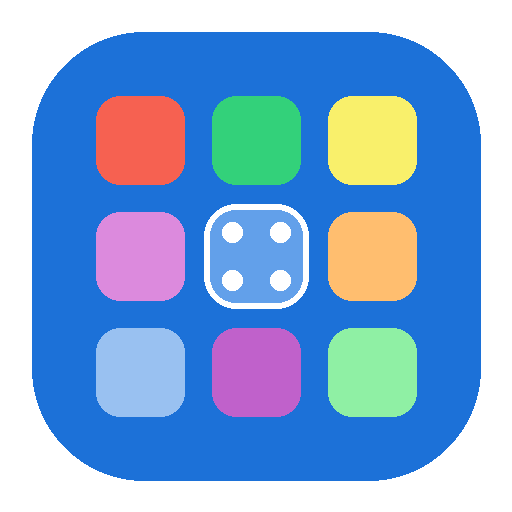

# GnomeAppMenuHelper 🚀
> **Визуальный редактор сетки приложений и папок GNOME**  
> *Visual GNOME App Grid, Folder and Page Organizer (GTK 4 / Libadwaita)*

<p align="center">
  
</p>

<p align="center">
  
  
  
  
  
</p>

---

## 🌟 Возможности / Features

### 🇷🇺 Русский
- **Нативный внешний вид GNOME Shell**: полупрозрачный тёмный фон, скругленные иконки приложений (squircle), центрированные подписи, круговые стрелки перехода между страницами.
- **Управление страницами**: создание новых страниц, удаление страниц, навигация стрелками `‹` и `›`, индикаторные точки пагинации внизу с прямым переключением.
- **Интуитивная организация (Drag & Drop и контекстное меню)**:
  - Перетаскивание приложений для изменения порядка.
  - Перетаскивание приложения на приложение для создания новой папки.
  - Перетаскивание в папку для быстрого добавления.
  - Контекстное меню (ПКМ): *Сдвинуть влево*, *Сдвинуть вправо*, *Переместить на страницу…*, *Поместить в папку…*, *Убрать со страницы*, *Скрыть из меню GNOME*, *Запустить приложение*.
- **Управление папками**:
  - Предпросмотр 2x2 мини-иконок внутри плитки папки.
  - Переименование папок.
  - Добавление и удаление приложений из папки.
  - Расформирование (распаковка) папки обратно на страницу.
- **Каталог всех приложений**: просмотр всех установленных приложений, поиск по названию/описанию, фильтрация скрытых приложений, добавление приложений на сетку в один клик.
- **Скрытие / отображение приложений**: скрытие ненужных или системных ярлыков из меню GNOME Shell (`NoDisplay=true`).
- **Сортировка по алфавиту**: быстрая сортировка приложений на странице или всей сетке (А-Я / A-Z).
- **Резервное копирование и восстановление**: мгновенное сохранение снимка сетки в JSON и восстановление в любой момент, а также сброс к стандарту GNOME.
- **Мгновенное применение**: кнопка «Применить в GNOME» синхронизирует настройки напрямую в `org.gnome.shell app-picker-layout` и `org.gnome.desktop.app-folders`.
- **4 языка интерфейса**: Русский (RU), Английский (EN), Испанский (ES), Французский (FR) с диалогом выбора языка при первом запуске и переключением на лету.

---

### 🇬🇧 English
- **Native GNOME Shell Aesthetic**: dark translucent canvas, squircle app icons, centered two-line labels, circular navigation arrows.
- **Full Page Management**: create and delete pages, navigate with `‹` and `›`, interactive bottom pagination dots.
- **Drag & Drop & Rich Context Menus**:
  - Reorder apps and folders visually.
  - Drag an app onto another to create a folder.
  - Drop apps directly into existing folders.
  - Right-click menu: *Move Left*, *Move Right*, *Move to Page…*, *Add to Folder…*, *Remove from Page*, *Hide from Menu*, *Launch Application*.
- **App Folders Management**:
  - 2x2 mini-icon folder preview.
  - In-place folder editor: rename, add apps from catalog, remove individual apps, or unpack folder.
- **Installed Apps Catalog**: browse all installed apps, search, filter hidden/unassigned, place on active page.
- **App Visibility Control**: toggle `NoDisplay` for any desktop entry.
- **Alphabetical Sorting**: 1-click A-Z layout sorting.
- **Backup & Restore**: save layout snapshots to JSON, restore or reset to GNOME defaults.
- **Instant GNOME Sync**: direct live synchronization with GNOME Shell GSettings without restarting the session.
- **Multi-language Support**: English, Russian, Spanish, and French with first-run welcome selector.

---

### 🇪🇸 Español
- **Estilo visual de GNOME Shell**: lienzo oscuro translúcido, iconos squircle, navegación de páginas con flechas y puntos inferiores.
- **Gestión completa de carpetas y páginas**: crear, eliminar, desempaquetar carpetas con vista previa 2x2.
- **Arrastrar y soltar + Menú contextual**: mover aplicaciones, crear carpetas al soltar, ordenar alfabéticamente.
- **Catálogo y visibilidad**: ocultar aplicaciones del menú, buscar y restaurar copias de seguridad.
- **4 idiomas**: ruso, inglés, español y francés.

---

### 🇫🇷 Français
- **Esthétique native GNOME Shell** : toile sombre translucide, icônes squircle, flèches de navigation et points de pagination.
- **Gestion complète des dossiers et pages** : créer, supprimer, dissoudre des dossiers avec aperçu 2x2.
- **Glisser-déposer et menu contextuel** : réorganiser, créer des dossiers, trier de A à Z.
- **Catalogue et masquage** : masquer des applications du menu, sauvegarder et restaurer.
- **4 langues** : français, anglais, russe et espagnol.

---

## 💻 Установка и запуск / Installation

### 1. Запуск без установки / Run directly
```bash
git clone https://github.com/misterkisik/gnome-app-menu-helper.git
cd gnome-app-menu-helper
./bin/gnome-app-menu-helper
```

### 2. Установка в систему через pip / User install via pip
```bash
pip install . --user
```

### 3. Сборка пакета для Arch Linux / Arch Linux package
```bash
makepkg -si
```

---

## 👤 Автор и копирайт / Author & Copyright
- **Автор**: MisterKisik
- **Copyright**: © 2026 MisterKisik
- **Лицензия**: [GNU General Public License v3.0](LICENSE)
